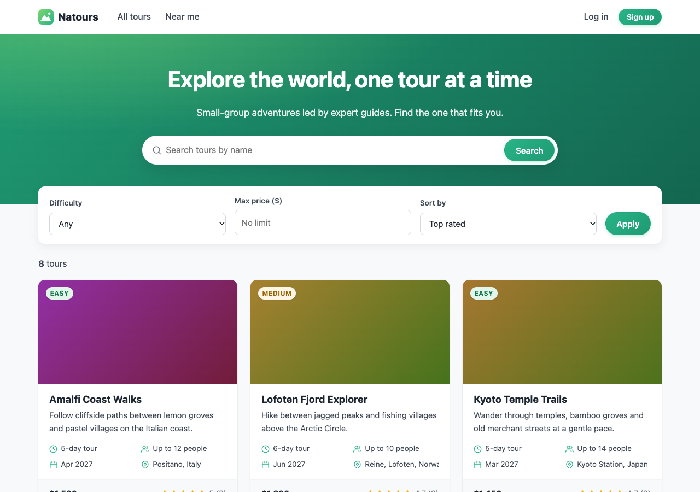
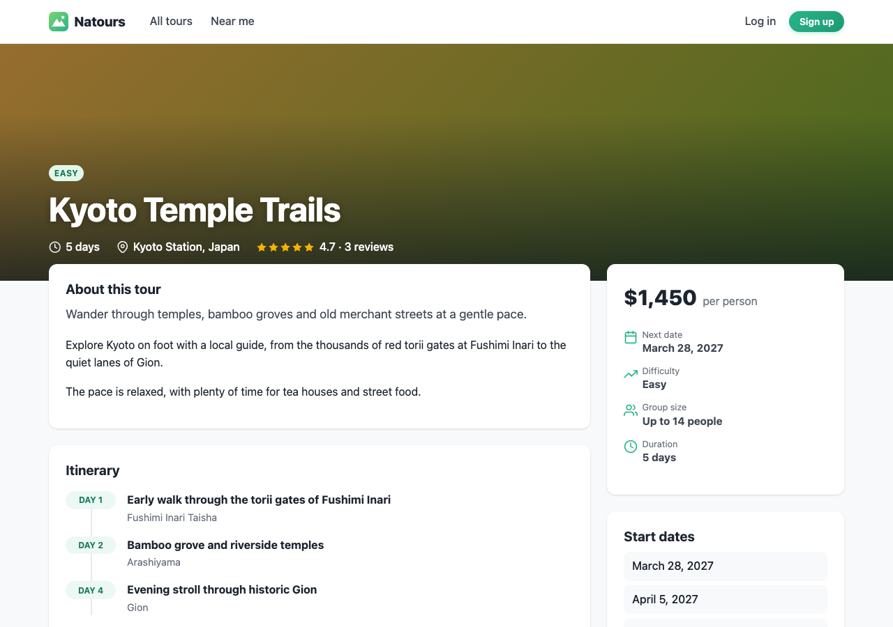
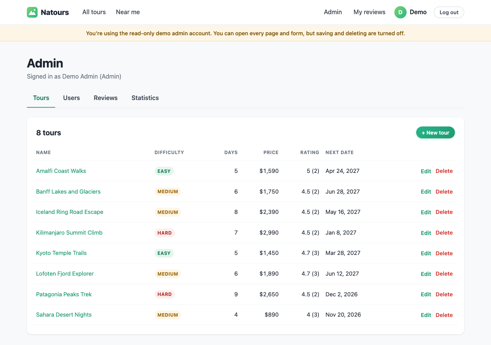

# Natours

A tour booking website built with **Node.js, Express, MongoDB and Pug**. Visitors can browse and search tours, read reviews and find tours near them. Customers can sign up and review the tours they've been on, and admins manage everything from an admin panel. Everything runs on a REST API that you can also call directly.

**Live demo:** link coming soon (hosted on Render)



## Try the demo

Log in with one of these accounts, or sign up for your own:

| Account | Email | Password | What you can do |
| --- | --- | --- | --- |
| Admin (read-only) | `demo.admin@example.com` | `demo1234` | Open the whole admin area: tours, users, reviews and statistics. Saving and deleting are turned off so the demo stays intact. |
| Customer | `demo.customer@example.com` | `demo1234` | Write, edit and delete your own reviews. Profile and password changes are turned off. |

The demo runs on Render's free plan, so the first page load after a quiet period can take about 30 seconds while the server wakes up.

## Features

### Visitors

- Browse tours with search, difficulty and price filters, sorting and pagination
- Tour pages with itinerary, start dates, guides and reviews
- "Near me": find tours that start within a distance of your location
- Sign up, log in and reset a forgotten password by email

### Customers

- Write, edit and delete reviews (one per tour); tour ratings update automatically
- "My reviews" page
- Update name and email, change password, deactivate the account

### Admins and lead guides

- Create, edit and delete tours, including start dates, start location and guides
- Moderate reviews
- Statistics by difficulty and a monthly overview of tour start dates
- Admins only: create users, change roles and delete users

| Tour page | Admin panel |
| --- | --- |
|  |  |

## Tech stack

- **Backend:** Node.js, Express 4, MongoDB with Mongoose 7
- **Frontend:** Pug templates rendered on the server, plain CSS and a small vanilla JavaScript file that calls the API
- **Auth:** JWT in an httpOnly cookie (or a `Bearer` token for API clients), bcrypt password hashing, role-based access
- **Security:** Helmet (with a Content Security Policy), rate limiting, NoSQL-injection and XSS sanitising
- **Email:** Nodemailer (for example with a Mailtrap inbox) for password resets

## Running it locally

You need Node.js 24 (the current LTS release; Node 25 and newer can't load the `jsonwebtoken` library yet) and a MongoDB database (a free [MongoDB Atlas](https://www.mongodb.com/atlas) cluster works).

```bash
git clone https://github.com/abriz19/the-natours-tour-project.git
cd the-natours-tour-project
npm install
cp .env.example .env      # then fill in your own values
npm run seed:demo         # optional: demo accounts, sample tours and reviews
npm start                 # http://localhost:4444 (or the PORT in .env)
```

To make your own account an admin, sign up on the site and then run:

```bash
npm run make-admin -- you@example.com
```

### Environment variables

| Variable | Description |
| --- | --- |
| `NODE_ENV` | `development` or `production` |
| `PORT` | Port to listen on (defaults to 3333) |
| `DATABASE` | MongoDB connection string. `<PASSWORD>` in it is replaced with `PASSWORD` |
| `PASSWORD` | Database password |
| `JWT_SECRET` | Long random string used to sign login tokens |
| `JWT_EXPIRES_IN` | How long a login lasts, for example `30d` |
| `JWT_COOKIE_EXPIRES_IN` | Cookie lifetime in days, for example `30` |
| `EMAIL_HOST`, `EMAIL_PORT`, `EMAIL_USERNAME`, `EMAIL_PASSWORD` | SMTP settings for password-reset emails |
| `EMAIL_FROM` | Optional sender, for example `Natours <hello@example.com>` |
| `TRUST_PROXY` | Only behind a hosting proxy: how many proxy hops to trust |

### npm scripts

| Script | What it does |
| --- | --- |
| `npm start` | Start the server with nodemon (restarts on changes) |
| `npm run start:pro` | Same, in production mode |
| `npm run seed:demo` | Create or reset the demo accounts, tours and reviews. Other data is left alone |
| `npm run import-data` / `npm run delete-data` | Import or delete the tours in `data/dev-data/tours-new.json` |
| `npm run make-admin -- <email>` | Give an existing user the admin role |

## API

All endpoints are under `/api/v1`. Protected routes accept the `jwt` cookie or an `Authorization: Bearer <token>` header.

| Method | Endpoint | Access |
| --- | --- | --- |
| GET | `/tours` (supports `?difficulty=easy&price[lte]=1000&sort=price&fields=name,price&page=2&limit=5`) | Public |
| GET | `/tours/:id` | Public |
| GET | `/tours/top-five-cheap-tours`, `/tours/get-stats`, `/tours/simple-route/:year` | Public |
| GET | `/tours/tours-withIn/:distance/center/:lat,:lng/unit/:km-or-mi` | Public |
| GET | `/tours/distances/:lat,:lng/unit/:km-or-mi` | Public |
| POST, PATCH, DELETE | `/tours`, `/tours/:id` | Admin, lead guide |
| GET, POST | `/tours/:tourId/reviews` | Logged in (POST: customers) |
| GET, PATCH, DELETE | `/reviews/:id` | Logged in; customers can only change their own |
| POST | `/users/signup`, `/users/login`, `/users/forgotPassword` | Public |
| GET | `/users/logout` | Public |
| PATCH | `/users/resetPassword/:token` | Public |
| GET | `/users/me` | Logged in |
| PATCH, DELETE | `/users/updateMe`, `/users/updatePassword`, `/users/deleteMe` | Logged in |
| GET, POST, PATCH, DELETE | `/users`, `/users/:id` | Admin |

## Deploying to Render

The repo includes a [Render Blueprint](render.yaml).

1. In MongoDB Atlas, go to **Network Access** and allow `0.0.0.0/0`, because Render's free plan has no fixed IP address.
2. In Render, choose **New > Blueprint**, connect this repository and pick the branch to deploy.
3. Fill in `DATABASE`, `PASSWORD` and the email settings when Render asks. `JWT_SECRET` is generated for you.
4. Once it's live, run `npm run seed:demo` locally against the same database to load the demo data.

## Project structure

```text
controllers/   request handlers (API, pages, auth, errors)
model/         Mongoose models: Tour, User, Review
routes/        API routes and page routes
views/         Pug templates (admin/ holds the admin pages)
public/        CSS, browser JavaScript and images
data/          seed data and scripts (seed-demo, import, make-admin)
utils/         helpers (API filtering, errors, email, view helpers)
```

## Acknowledgements

I started this project while following Jonas Schmedtmann's [Node.js, Express, MongoDB & More: The Complete Bootcamp](https://www.udemy.com/course/nodejs-express-mongodb-bootcamp/) on Udemy, and then extended it with the Pug website, the admin panel and the public demo.
